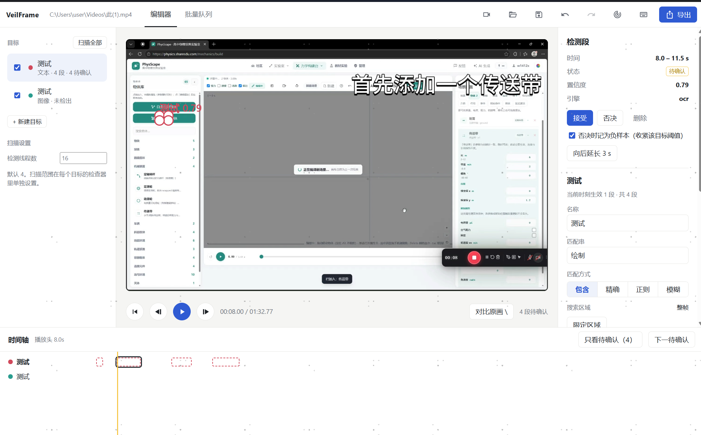

<p align="center">
  
</p>

<h1 align="center">VeilFrame</h1>

<p align="center">
  Offline desktop tool for masking recurring targets in local videos.<br>
  <a href="README.zh-CN.md">简体中文</a> · English
</p>

---

VeilFrame finds text, images, and fixed regions that appear in a video and masks them (mosaic, blur, or solid fill). You define the targets, the app scans the video and proposes every occurrence, and you review the results before exporting.

Everything runs on your machine. The video, the OCR models, and the cache never leave the computer.

## Screenshot

<p align="center">
  
</p>

## Features

- **Three target types**
  - **Text**: OCR-based matching with contains, exact, regex, and fuzzy (edit distance) modes. Full-width and half-width characters and letter case are normalized.
  - **Image**: matches one or more template variants with SIFT + RANSAC or multi-scale NCC.
  - **Region**: a fixed rectangle that is masked over a time range, with no detection.
- **Per-target settings**: scan range, search area (ROI), detection threshold, mask style, and color.
- **Multi-threaded scanning**: 4 workers by default, adjustable from 1 to 16.
- **OCR cache**: recognized text is stored per frame. Editing a text target's pattern, match mode, threshold, or ROI re-matches the cached text and does not decode the video or run OCR again.
- **Review workflow**: detections are grouped into segments with a confidence score. Low-confidence segments are flagged. Accept or reject each segment, and rejections can feed back into the target's threshold as negative samples.
- **Real-time preview**: masks are drawn on a canvas while you scrub or play.
- **Timeline**: zoom with Ctrl + wheel, drag the ruler to seek, navigate with the overview bar, and hover to see a thumbnail of any moment.
- **Masking**: mosaic, Gaussian blur, and solid fill, with edge feathering and motion-aware padding.
- **Export**: H.264 via x264 by default, or NVENC, Quick Sync, and AMD AMF when the hardware is available. When the source is H.264 and the encoder is libx264, smart render re-encodes only the groups of pictures (GOPs) that contain masks and copies the rest.
- **Batch queue**: scan and export several projects in one run.
- **Project files**: work is saved to a `.maskproj` file next to the video. The source video is never modified.

## Download

Installers for Windows (NSIS), macOS (Apple Silicon, DMG), and Linux (AppImage and DEB) are published on the [Releases](https://github.com/W1412X/VeilFrame/releases) page. The installers include FFmpeg, ONNX Runtime, and the OCR models.

## Quick start

1. Open a video.
2. Add a target: type a text pattern, import an image, or draw a region.
3. Set the scan range and search area if you only need part of the frame or part of the video.
4. Scan the target (or all targets).
5. Review the segments on the timeline. Use `F` to jump to the next pending segment, `Enter` to accept, and `Delete` to reject.
6. Export. Choose whether pending segments are masked and set the encoder and quality.

### Keyboard shortcuts

| Key | Action |
|---|---|
| `Space` | Play or pause |
| `←` / `→` | Step one frame (`Shift` for one second) |
| `F` | Next pending segment |
| `Enter` / `Delete` | Accept / reject the selected segment |
| `Ctrl+Z` / `Ctrl+Shift+Z` | Undo / redo |
| `\` | Toggle the original picture |
| `E` | Export |
| `+` / `-` / `0` | Zoom timeline in / out / fit |
| `Home` / `End` | Jump to start / end |

## Build from source

### Requirements

- Rust (stable) and Cargo
- Node.js 20 or later
- OpenCV 4.10 with its development files, and libclang (used by the `opencv` crate's bindings)
- FFmpeg and FFprobe on `PATH`, or set through the environment variables below
- ONNX Runtime shared library (1.20 is tested)
- PP-OCRv5 models: detection (`det_v5.onnx`), recognition (`rec_v5.onnx`), and the character dictionary (`ppocr_keys_v5_onnx.txt`)
- On Linux, the Tauri prerequisites, including WebKitGTK 4.1 (see the [Tauri guide](https://v2.tauri.app/start/prerequisites/))

The CI workflows in `.github/workflows/` show how each dependency is installed and where the models are downloaded from.

### Run the tests

```bash
cargo test --workspace --locked

cd app
npm ci
npm run typecheck
npm test
```

### Run the desktop app

```bash
cd app
npm ci
npm run tauri dev
```

### Build an installer

```bash
cd app
npm run tauri build
```

## Configuration

These environment variables are read at startup. Defaults are shown in parentheses.

| Variable | Purpose |
|---|---|
| `VF_FFMPEG` (`ffmpeg`) | Path to the FFmpeg binary |
| `VF_FFPROBE` (`ffprobe`) | Path to the FFprobe binary |
| `VF_ORT_LIB` (`ORT_DYLIB_PATH`) | Path to the ONNX Runtime shared library |
| `VF_MODELS_DIR` (`~/.veilframe/models`) | Folder that contains the OCR model files |
| `VF_OCR_DET` / `VF_OCR_REC` / `VF_OCR_DICT` | Override the individual OCR model file paths |
| `VF_CACHE_DB` (`$XDG_CACHE_HOME/veilframe/cache.db`) | Location of the perceptual and OCR cache database |

## Project layout

```
app/            React + TypeScript front end and the Tauri shell (app/src-tauri)
crates/
  vf-project    project model and validation (.maskproj)
  vf-core       editing operations and undo history
  vf-session    orchestrates scans, exports, and the cache from the UI
  vf-pipeline   frame sampling, detector pipeline, and the scan loop
  vf-ocr        PP-OCRv5 text detection and recognition (ONNX Runtime)
  vf-text       text matching: normalization, contains, regex, fuzzy
  vf-vision     SIFT + RANSAC and NCC template matching
  vf-fusion     temporal fusion, NMS, and smoothing of detections
  vf-cache      SQLite cache for detections and OCR results
  vf-render     mask rendering (mosaic, blur, solid, feathering)
  vf-export     export pipeline and smart render
  vf-media      FFmpeg and FFprobe integration
  vf-queue      batch queue
docs/           architecture decision records (docs/adr) and notes
first_design.md full design document
```

## Limitations

VeilFrame is an early-stage project. Some parts are planned but not finished:

- The **Image** mask style is declared but not rendered yet.
- AKAZE, SuperPoint + LightGlue, and shape-edge matching are declared but not implemented. Image targets currently use NCC or SIFT + RANSAC.
- Frames between samples are not tracked with optical flow. Detections are fused across sampled frames only.
- Hardware encoders (NVENC, QSV, AMF) depend on the local driver and have not been verified on every platform.
- The OCR text cache stores whole-frame results. Text that straddles the edge of a search area may match differently from earlier versions that cropped before recognition.

## License

No license has been chosen yet. The workspace is currently marked `UNLICENSED`, so the code is not open source until a license file is added.

## Acknowledgements

VeilFrame builds on [OpenCV](https://opencv.org/), [ONNX Runtime](https://onnxruntime.ai/), [FFmpeg](https://ffmpeg.org/), [PaddleOCR](https://github.com/PaddlePaddle/PaddleOCR) (PP-OCRv5 models), and [Tauri](https://tauri.app/).
