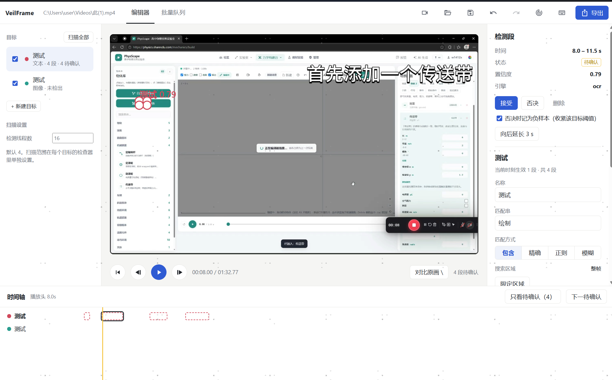

<p align="center">
  
</p>

<h1 align="center">VeilFrame</h1>

<p align="center">
  本地离线的桌面视频目标打码工具。<br>
  <a href="README.md">English</a> · 简体中文
</p>

---

VeilFrame 在视频中找到反复出现的文字、图像和固定区域，并进行打码（马赛克、模糊或纯色覆盖）。你先定义目标，程序扫描视频并列出每一次出现的位置，导出前由你复核结果。

全部处理都在本机完成。视频、OCR 模型和缓存都不会离开这台电脑。

## 界面截图

<p align="center">
  
</p>

## 功能特性

- **三类目标**
  - **文字**：基于 OCR 的匹配，支持包含、精确、正则和模糊（编辑距离）四种方式。匹配时会统一全角半角和大小写。
  - **图像**：使用 SIFT + RANSAC 或多尺度 NCC 模板匹配，可挂载多个模板变体。
  - **固定区域**：在指定时间段内直接打码一个矩形区域，不做检测。
- **每个目标单独设置**：扫描范围、搜索区域（ROI）、检测阈值、打码样式和颜色。
- **多线程扫描**：默认 4 个线程，可在 1 到 16 之间调整。
- **OCR 缓存**：识别出的文字按帧保存。修改文字目标的模式串、匹配方式、阈值或搜索区域时，程序直接在缓存的文字上重新匹配，不再解码视频，也不再重新运行 OCR。
- **复核流程**：检测结果按段组织，每段带置信度，低置信度的段会被标出。可以逐段接受或否决，否决的结果会作为负样本反馈到该目标的阈值。
- **实时预览**：拖动时间轴或播放时，打码效果实时绘制在画布上。
- **时间轴**：Ctrl + 滚轮缩放，拖动标尺定位，用总览条快速移动，悬停可查看对应时刻的缩略图。
- **打码样式**：马赛克、高斯模糊和纯色覆盖，支持边缘羽化和运动感知的外扩。
- **导出**：默认使用 x264 软件编码输出 H.264。硬件可用时，也可选 NVENC、Quick Sync 或 AMD AMF。源视频为 H.264 且编码器为 libx264 时，智能渲染只重新编码含有打码的 GOP（图像组），其余部分直接拷贝。
- **批量队列**：一次扫描或导出多个项目。
- **项目文件**：工作进度保存到视频旁边的 `.maskproj` 文件中，源视频始终只读。

## 下载

Windows（NSIS 安装包）、macOS（Apple Silicon，DMG）和 Linux（AppImage 与 DEB）的安装包发布在 [Releases](https://github.com/W1412X/VeilFrame/releases) 页面。安装包内已包含 FFmpeg、ONNX Runtime 和 OCR 模型。

## 快速开始

1. 打开一个视频。
2. 添加目标：输入文字模式串、导入图片，或框选一个区域。
3. 如果只需要处理部分画面或部分时间段，设置扫描范围和搜索区域。
4. 扫描单个目标或全部目标。
5. 在时间轴上复核检测段。按 `F` 跳到下一个待确认段，`Enter` 接受，`Delete` 否决。
6. 导出。选择待确认段是否打码，并设置编码器和质量。

### 快捷键

| 按键 | 作用 |
|---|---|
| `Space` | 播放 / 暂停 |
| `←` / `→` | 逐帧移动（按住 `Shift` 为逐秒） |
| `F` | 跳到下一个待确认段 |
| `Enter` / `Delete` | 接受 / 否决选中的段 |
| `Ctrl+Z` / `Ctrl+Shift+Z` | 撤销 / 重做 |
| `\` | 切换原画对比 |
| `E` | 导出 |
| `+` / `-` / `0` | 时间轴放大 / 缩小 / 适应全部 |
| `Home` / `End` | 跳到开头 / 结尾 |

## 从源码构建

### 依赖

- Rust（stable）和 Cargo
- Node.js 20 或更高版本
- OpenCV 4.10 及其开发文件，以及 libclang（供 `opencv` crate 生成绑定）
- FFmpeg 和 FFprobe，需在 `PATH` 中，或通过下方的环境变量指定
- ONNX Runtime 动态库（已测试 1.20）
- PP-OCRv5 模型：检测模型 `det_v5.onnx`、识别模型 `rec_v5.onnx` 和字符表 `ppocr_keys_v5_onnx.txt`
- Linux 上需要 Tauri 的系统依赖，包括 WebKitGTK 4.1（参见 [Tauri 官方说明](https://v2.tauri.app/start/prerequisites/)）

`.github/workflows/` 中的 CI 配置展示了各项依赖的安装方式，以及模型的下载地址。

### 运行测试

```bash
cargo test --workspace --locked

cd app
npm ci
npm run typecheck
npm test
```

### 启动桌面应用

```bash
cd app
npm ci
npm run tauri dev
```

### 打包安装程序

```bash
cd app
npm run tauri build
```

## 配置

以下环境变量在启动时读取，括号中为默认值。

| 变量 | 用途 |
|---|---|
| `VF_FFMPEG`（`ffmpeg`） | FFmpeg 可执行文件路径 |
| `VF_FFPROBE`（`ffprobe`） | FFprobe 可执行文件路径 |
| `VF_ORT_LIB`（`ORT_DYLIB_PATH`） | ONNX Runtime 动态库路径 |
| `VF_MODELS_DIR`（`~/.veilframe/models`） | 存放 OCR 模型文件的目录 |
| `VF_OCR_DET` / `VF_OCR_REC` / `VF_OCR_DICT` | 单独指定各个 OCR 模型文件的路径 |
| `VF_CACHE_DB`（`$XDG_CACHE_HOME/veilframe/cache.db`） | 感知缓存和 OCR 缓存数据库的位置 |

## 项目结构

```
app/            React + TypeScript 前端，以及 Tauri 外壳（app/src-tauri）
crates/
  vf-project    项目模型与校验（.maskproj）
  vf-core       编辑操作与撤销历史
  vf-session    从界面协调扫描、导出和缓存
  vf-pipeline   抽帧、检测流水线与扫描循环
  vf-ocr        PP-OCRv5 文字检测与识别（ONNX Runtime）
  vf-text       文字匹配：归一化、包含、正则、模糊
  vf-vision     SIFT + RANSAC 与 NCC 模板匹配
  vf-fusion     时序融合、NMS 与平滑
  vf-cache      检测结果与 OCR 结果的 SQLite 缓存
  vf-render     打码渲染（马赛克、模糊、纯色、羽化）
  vf-export     导出流水线与智能渲染
  vf-media      FFmpeg / FFprobe 集成
  vf-queue      批量队列
docs/           架构决策记录（docs/adr）与说明文档
first_design.md 完整设计文档
```

## 已知限制

VeilFrame 仍处于早期阶段，部分功能已规划但尚未完成：

- **图像**打码样式已声明，但还没有渲染实现。
- AKAZE、SuperPoint + LightGlue 和形状边缘匹配已声明但未实现。图像目标目前使用 NCC 或 SIFT + RANSAC。
- 采样帧之间的画面没有使用光流跟踪，检测结果只在采样帧之间做融合。
- 硬件编码器（NVENC、QSV、AMF）依赖本机驱动，尚未在所有平台上验证。
- OCR 文字缓存保存的是整帧的识别结果。跨越搜索区域边缘的文字，匹配结果可能与早期版本（识别前先裁剪）不同。

## 许可证

尚未选择许可证。工作区目前标记为 `UNLICENSED`，在添加许可证文件之前，代码不属于开源。

## 致谢

VeilFrame 基于 [OpenCV](https://opencv.org/)、[ONNX Runtime](https://onnxruntime.ai/)、[FFmpeg](https://ffmpeg.org/)、[PaddleOCR](https://github.com/PaddlePaddle/PaddleOCR)（PP-OCRv5 模型）和 [Tauri](https://tauri.app/) 构建。
